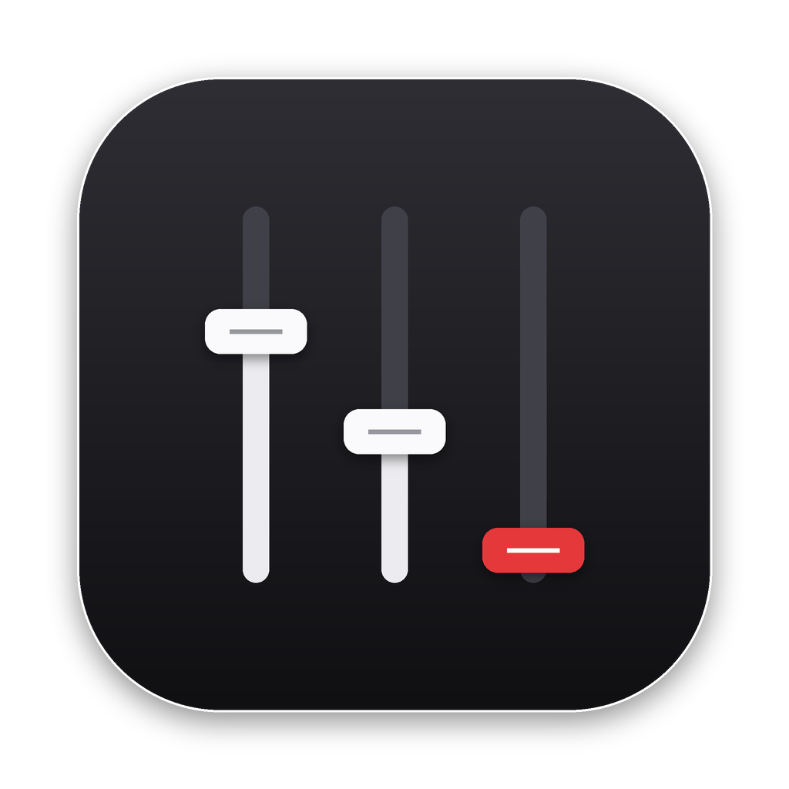

<p align="center">
  
</p>

<h1 align="center">Hush</h1>

<p align="center">
  <b>Mute the iOS Simulator — one window, one app, or all of them.</b><br>
  A menu bar mixer for macOS that keeps simulators quiet through every rebuild,<br>
  plus per-app volume for everything else.
</p>

<p align="center">
  <a href="https://github.com/malong954/Hush/releases/latest">Download</a> ·
  <a href="#build-from-source">Build from source</a> ·
  <a href="#how-it-works">How it works</a>
</p>

---

If you run apps or games in the Simulator all day — especially with AI coding agents or CI
rebuilding and relaunching them constantly — you know the soundtrack. macOS has no per-app
volume, and muting a simulator lasts until the next build. Hush fixes that.

```
┌───────────────────────────────────────────┐
│ ⫶ Hush                   🔈 AirPods    ⚙  │
│ ┌───────────────────────────────────────┐ │
│ │ 📵 Mute all Simulators          [ ●] │ │
│ │    3 of 4 muted                      │ │
│ └───────────────────────────────────────┘ │
│ SIMULATORS                                │
│ ▾ 📱 iPhone 17 Pro      1 of 2 muted  🔊  │
│      iOS 26.5 · 2 apps  ━━━━━━━━━━━━━     │
│        ▢ My Game •                    🔊  │
│        ▢ SpringBoard          Muted   🔇  │
│ ▸ 📱 iPhone 17                Muted   🔇  │
│ ▸ 📱 iPad mini (A17 Pro)      Muted   🔇  │
│ APPS                                      │
│ ▸ ▢ Google Chrome   ━━━━━○─────  60%  🔊  │
│   ▢ Spotify •       ━━━━━━━━━━━ 100%  🔊  │
└───────────────────────────────────────────┘
```

## Features

- **Mute all Simulators** — one switch for every iOS, iPadOS, watchOS and visionOS simulator and
  the Android Emulator, including simulators booted later and every relaunch.
- **Per simulator window** — each booted simulator is its own row, named like in Simulator's
  Dock menu. Mute it, set its volume, or expand it to mute single apps inside it.
- **Survives rebuilds** — settings are keyed by simulator UDID and bundle ID, not by process.
  On macOS 26, relaunches are silent from the very first sample.
- **Per-app volume for Mac apps** — mute or turn down Spotify, Chrome, Slack… Rules apply again
  every time the app launches.
- **Zero overhead at 100%** — apps you haven't touched are left completely alone.
- **Private** — no network access, nothing recorded or saved. Open source under GPL-3.0.

## Install

1. Download the latest **Hush-x.y.z.dmg** from [Releases](https://github.com/malong954/Hush/releases/latest).
2. Open it and drag **Hush** to **Applications**, then open Hush. A speaker icon appears in the
   menu bar.
3. The first time Hush controls an app, macOS asks for **System Audio Recording** permission →
   **Allow**. That's what lets Hush re-play an app's sound at a different volume; nothing is
   recorded.

Optional: ⚙ → **Launch at login**.

**Requirements:** macOS 14.2 or later, Apple silicon or Intel. macOS 26 recommended for
instant muting on relaunch.

## Using it

| Control | What it does |
|---|---|
| **Mute all Simulators** | Mutes every simulator and emulator, now and later. Flipping it clears any exceptions below, so "all" means all. |
| **▸ Simulator row** | One simulator window. Mute it or set its volume; sticks through rebuilds. |
| **Expanded simulator** | The apps running inside it (your app, SpringBoard…), each with its own mute. |
| **▸ App row** | A Mac app: volume + mute. If it plays through several processes, expand it to mute them one by one (for the session). |
| *Applied when they launch* | Rules for Mac apps that aren't running right now. ✕ forgets one. |
| ⚙ → Show background processes | Also list daemons and helpers that use audio. |
| ⚙ → Reset everything | Clears every rule and turns the Simulator switch off. |

The most specific setting wins: *all Simulators → one simulator → one app in it*, and
*Mac app → one of its processes*. "3 of 4 muted" means some children differ from their parent.

**Browsers:** Chrome and Safari play every tab and window through one shared audio process, so
macOS can't tell their windows apart. Use the browser's own tab mute (right-click a tab →
*Mute site*) and Hush for the browser as a whole.

## Build from source

Needs Xcode 15.3+ (or its command line tools) on macOS 14.2+.

```bash
git clone https://github.com/malong954/Hush.git
cd Hush
./build.sh install      # builds, signs, copies to /Applications and launches
```

`./build.sh` alone produces `build/Hush.app`. If you have an *Apple Development* certificate,
it's used automatically so macOS keeps the audio permission across rebuilds.

To produce a signed, notarized DMG yourself, see [DISTRIBUTION.md](DISTRIBUTION.md).

## How it works

**Muting and turning down** work the same way, per process: Hush creates a Core Audio
[process tap](https://developer.apple.com/documentation/coreaudio/catapdescription) with
`.muted` for the process, pairs it with your output device in a private aggregate device, and
runs a real-time callback that re-plays the audio at your volume — silence at 0%. A tap only
takes effect while something reads it, so each one has its own always-running reader. Each
process's tap is created once when the process appears and left alone until it exits, so a new
copy of an app in another simulator, or a relaunch, never disturbs copies already muted. Moving
between muted and any volume is just a gain change (30 ms ramp); when your output device
changes, each new tap is running before its old one is removed.

On **macOS 26+** Hush also keeps one *standing* tap for the bundle IDs that should stay muted
(`CATapDescription.bundleIDs` + `isProcessRestoreEnabled`). macOS re-attaches it the moment one
of those apps starts again — before Hush has even seen the new process.

**Finding the simulator:** each simulator window runs its own process tree under its own
`launchd_sim`. Hush finds which simulator a process belongs to from its device folder
(`…/CoreSimulator/Devices/<UDID>/…`), its `SIMULATOR_UDID` / `HOME` environment, or its
`launchd_sim` parent, and names it from that simulator's `device.plist`. Android emulators are
split per AVD. On the Mac side, browser and Electron helpers are folded into their app and
Safari's WebKit audio process is credited to Safari.

Standing taps match by bundle ID, which can't tell simulators apart, so Hush only uses them
while *every* simulator is muted with no exceptions, and never while a process with that bundle
ID is meant to be heard.

### Source layout

| File | Role |
|---|---|
| `Sources/Hush/Audio/AppVolumeTap.swift` | Tap + aggregate device + real-time gain callback (0 = muted) |
| `Sources/Hush/Audio/TapDescriptions.swift` | Per-process and standing (macOS 26) tap descriptions |
| `Sources/Hush/Audio/AudioProcessScanner.swift` | Finds audio processes, groups them into apps and simulators |
| `Sources/Hush/Audio/AudioPermission.swift` | Reads/requests the System Audio Recording permission |
| `Sources/Hush/Audio/CoreAudioHelpers.swift` | Core Audio property helpers |
| `Sources/Hush/Mixer.swift` | Rules, persistence, keeps taps in sync with rules and devices |
| `Sources/Hush/Views/MixerView.swift` | The menu bar panel |
| `build.sh` / `release.sh` | Development build / notarized DMG ([DISTRIBUTION.md](DISTRIBUTION.md)) |
| `scripts/assemble-app.sh` | Bundle layout, icon, version stamp, license files |

## Troubleshooting

- **An app goes silent at 40% instead of quieter** → the permission isn't granted. System
  Settings → Privacy & Security → Screen & System Audio Recording → *System Audio Recording
  Only* → enable Hush, then move that app's slider once.
- **A row shows a red error** → that process's tap couldn't be created (usually it quit
  mid-setup). Hush retries every few seconds.
- **Updating or quitting Hush** hands every app's audio back until it starts again — expect a
  moment of sound while it re-mutes everything (busiest processes first).
- **Your Mac build of a game shares its Simulator bundle ID** → the standing tap steps aside
  while the Mac build runs, so muting the Simulator never mutes the Mac app.
- **Apps that pick their own output device** (DAWs, some games) are re-played on the system
  default output instead.

Found a bug? [Open an issue](https://github.com/malong954/Hush/issues/new/choose) with your
macOS version and what's in the Hush panel.

## Why not the Mac App Store?

Hush reads simulator device folders and other processes' environment to tell simulator windows
apart, and uses two private macOS calls (the audio-permission check and helper-to-app
attribution). The App Store sandbox and review don't allow those, so Hush ships as a
notarized download instead.

## Contributing

Issues and pull requests are welcome — see [CONTRIBUTING.md](CONTRIBUTING.md).

## License

Hush is free software under the **GNU General Public License v3.0 or later** — see
[LICENSE](LICENSE). It builds on [FineTune](https://github.com/ronitsingh10/FineTune) (GPL-3.0)
and [AudioCap](https://github.com/insidegui/AudioCap) (BSD 2-Clause); see
[NOTICE.md](NOTICE.md) for details and their license terms.

© 2026 Flip Digital Labs
